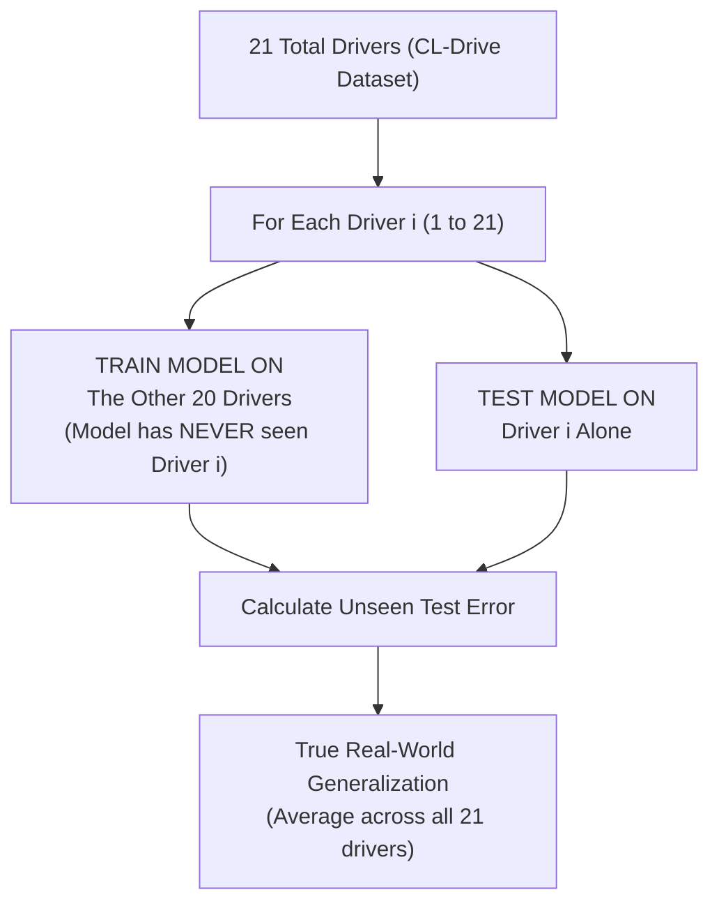
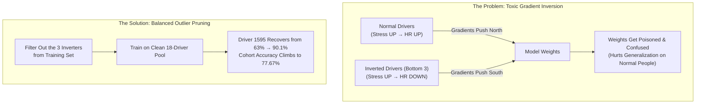

# Driver Cognitive State Classification (Official Benchmark)

> **Real-time AI for automotive cockpits:** Detects driver mental workload and cognitive overload from wearable and in-cabin physiological sensors (ECG, EDA, EEG, Eye Gaze) to prevent accidents in semi-autonomous driving.

---

## 1. How It Works (For Non-Experts & Laymen)

When driving conditions get intense (heavy traffic, rainstorms, unexpected hazards), your body involuntarily reacts:
* **Heart (ECG):** Beats faster; beat-to-beat variability drops.
* **Skin (EDA):** Micro-sweat glands fire on the fingers and palms.
* **Brain (EEG):** High-frequency Beta waves surge; relaxed Alpha waves disappear.
* **Eyes (Gaze):** Pupils dilate and blink frequency drops.

This AI model monitors these 4 body systems simultaneously every 10 seconds, filters out personal physical differences using a **quick 20-second calm cruise calibration**, and predicts the driver's cognitive workload state (**Low**, **Medium**, or **High**).

```mermaid
flowchart LR
    subgraph Sensors["1. Raw Biosensors (12 Channels)"]
        S1["ECG (Heart)"]
        S2["EDA (Skin Sweat)"]
        S3["EEG (Brain)"]
        S4["Gaze (Pupils/Blinks)"]
    end

    subgraph Preprocess["2. Live Processing"]
        P1["10s Windows @ 100 Hz<br/>(1,000 steps)"]
        P2["Live 20s Warm-Up<br/>Calibration (Approach B)"]
    end

    subgraph AI["3. Multimodal Transformer"]
        M1["1D-CNN Stems<br/>(Extract Wave Shapes)"]
        M2["Cross-Modal Attention<br/>(Fuses Body Signals)"]
    end

    subgraph Decisions["4. Live In-Car Output"]
        D1["3-Class Alert Level<br/>(Low / Med / High)"]
        D2["Continuous Workload<br/>(1.0 to 9.0 Difficulty)"]
    end

    Sensors --> P1 --> P2 --> M1 --> M2 --> Decisions
```



---

## 2. Why Validation is Honest: Leave-One-Subject-Out (LOSO)

Standard AI projects often make a fatal mistake: they randomly mix samples from the same person into training and testing. The model gets a "fake 95% accuracy" simply by memorizing individual driver fingerprints (e.g. your resting heart rate).

In this project, we use **21-Fold Leave-One-Subject-Out (LOSO)**:



---

## 3. The Outlier Pruning Breakthrough (Why Filter the Bottom 3?)

People are wired differently:
* **18 Drivers (Typical Responders):** Heart rate and sweat rise with driving difficulty.
* **3 Drivers (Inverted / Atypical Responders: `1372`, `1544`, `1547`):** Showed paradoxical autonomic responses (heart rate dropped or skin conductance habituated during extreme stress).



---

## 4. Setup Guide (Quick Start)

### Step 1: Create Virtual Environment
```bash
# In the repository directory:
python3 -m venv venv
source venv/bin/activate
```

### Step 2: Install Libraries
```bash
pip install -r requirements.txt
```

### Step 3: Dataset Preparation (Raw Download → Preprocessing)

You don't need any special directory setup. You can download the raw CL-Drive dataset and process it in one command:

1. **Download & Extract CL-Drive:**
   * Download the dataset from [Borealis Dataverse (DOI: 10.5683/SP3/JJ2YZZ)](https://doi.org/10.5683/SP3/JJ2YZZ).
   * Extract the downloaded folder anywhere on your computer (e.g. `raw_cldrive/` containing `ECG/`, `EDA/`, `EEG/`, `Gaze/`, `Labels/`).

2. **Run the Preprocessing Script:**
   ```bash
   python preprocess_dataset.py --raw_dir /path/to/extracted/raw_cldrive
   ```
   * What this does automatically:
     * Discovers all 21 driver trials across 9 complexity levels.
     * Synchronizes and resamples the 12 multi-rate channels to a uniform **100 Hz grid** (10-second windows = 1,000 time steps).
     * Saves the preprocessed tensor archive to `data/cldrive_windowed_100hz.npz`.

> *(Note: If you already have `cldrive_windowed_100hz.npz`, simply place it in the `data/` folder and skip this step).*

---

## 5. Running the Pipeline

### Full 21-Fold LOSO Benchmark (Recommended)
Runs training and evaluation across all 21 drivers:
```bash
python main.py
```

### Quick Sanity Test (2 Folds, 2 Epochs)
To verify everything runs on your machine in under 15 seconds:
```bash
python main.py --folds 2 --epochs 2
```

### Compare Against Unpruned Baseline
To observe the effect of toxic gradient corruption without outlier filtering:
```bash
python main.py --no-prune
```

---

## 6. Understanding the Stdout Output

When running `python main.py`, each fold logs the test performance on an unseen driver:

```text
Fold   | Test ID | Cohort   | 3-Cls Acc  | F1-Weighted | Level MAE  | Pearson r | 9-Cls Adj
-------------------------------------------------------------------------------------------
[01/21] | 1030    | Curated  |    80.25% |     79.78% |      0.91  |     0.86  |    83.33%
[02/21] | 1105    | Curated  |    87.65% |     87.96% |      0.94  |     0.87  |    80.86%
...
-------------------------------------------------------------------------------------------
MEAN   | ALL     | -        |    77.67% |     77.20% |      1.24  |     0.79  |    73.10%
```

### Metric Definitions:
* **3-Cls Acc (3-Class Accuracy):** Categorical decision accuracy between Low (1–3), Medium (4–6), and High (7–9) workload (Random chance = 33.3%).
* **F1-Weighted:** Precision and recall balance across class distributions.
* **Level MAE (Mean Absolute Error):** How close continuous predictions are to true difficulty (1 to 9 scale). An MAE of 1.24 means errors are barely $\pm 1$ level off!
* **Pearson r:** Trend correlation between predicted and true workload ($r \ge 0.75$ represents strong linear alignment).
* **9-Cls Adj ($\pm 1$ Adjacent Accuracy):** Percentage of times the prediction is exactly right or within $\pm 1$ neighbor level (Chance = ~30%, ours reaches ~73%).

Full per-fold metrics are automatically exported to `results/loso_evaluation_results.csv`.

---

## 7. Command-Line Arguments Reference

| Argument | Default | Description |
| :--- | :---: | :--- |
| `--data_path` | `data/cldrive_windowed_100hz.npz` | Path to dataset archive |
| `--epochs` | `15` | Training epochs per fold |
| `--batch_size` | `32` | DataLoader batch size |
| `--lr` | `3e-4` | AdamW learning rate |
| `--calib_seconds` | `20` | Duration of initial calm driving used for warm-up calibration |
| `--prune` / `--no-prune`| `True` | Filter bottom 3 toxic inverters from training pool |
| `--folds` | `None` (all 21) | Limit fold count for quick checks |
| `--device` | `cuda` | Hardware accelerator (`cuda` or `cpu`) |
